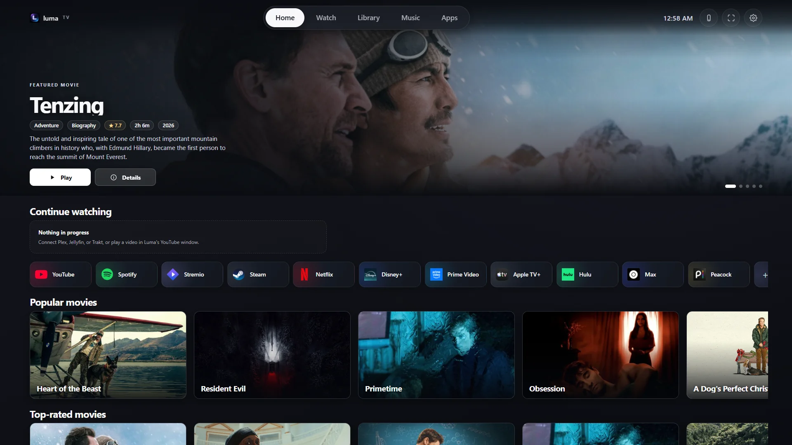
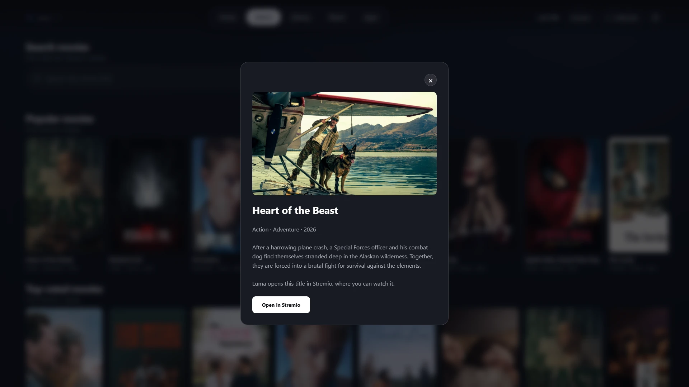
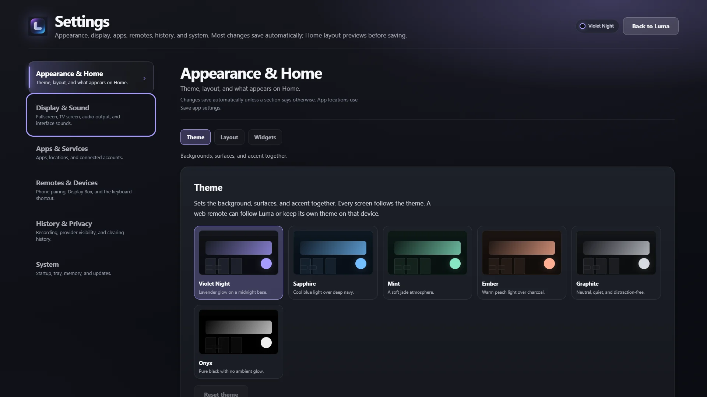

<p align="center">
  
</p>

<h1 align="center">Luma TV</h1>

<p align="center">
  <strong>Your entertainment, together.</strong><br />
  A TV launcher for Windows. Control it from the couch with a keyboard or your phone.
</p>

<p align="center">
  
  
  
  
</p>

<p align="center">
  
  <br />
  <em>Apps, catalogs, and unfinished titles on one home screen.</em>
</p>

## One screen

Luma is a launcher, not another streaming stack. It reads what you already have on the PC and puts Netflix, Stremio, Plex, Spotify, and the rest behind one fullscreen UI you can drive from across the room.

Open a service from the dock, pick something from Cinemeta, or resume what you left off. Arrow keys, Enter, and Back are enough. If you prefer, pair a phone on the same Wi-Fi and use it as a remote.

## Design goals

Luma groups apps, video, and music in one place instead of a pile of windows and tabs. Type and focus are sized for TV distance. You keep your existing accounts and watch history. Luma does not mint a parallel library or ship its own player for protected streams.

Watch history sits in a local SQLite file. Tokens go into Windows Credential Manager. The phone remote is LAN-only by default. You can start Luma with Windows, park it in the tray, and forget about it until you need the home screen again.

## Features

| | |
| --- | --- |
| Continue Watching | One row for in-progress films, episodes, and tracks from launches inside Luma plus YouTube, Spotify, Plex, Jellyfin, and Trakt. Stremio gets its own row after you link an account. |
| App dock | Netflix, Disney+, Prime Video, Apple TV+, Hulu, Max, Peacock, YouTube, Spotify, Stremio, and a custom tile. Luma detects installed desktop apps. Services without one open in a dedicated fullscreen browser window. |
| Catalog browse | Popular and highly rated titles from Stremio's public Cinemeta feed: posters, ratings, runtime, description, and search, without starting another app first. |
| Stremio account | Pair with a short device code, pull library and Continue Watching, open titles in Stremio's official web player inside Luma. |
| Spotify | Playlists, saved albums, liked songs, search, device picking, and transport controls from the TV UI. |
| Phone remote | Same Wi-Fi, scan the QR code to pair, add it to your phone's home screen, then control Luma with a D-pad or touchpad, playback, volume, and a separate apps screen. A Display Box frame can pair too. |
| In-app control | While a launched app is focused, the remote can move the mouse and click inside it. Home returns you to Luma. |
| TV layout | 10-foot typography, six themes, reorderable home rows and hero, widget placement, drag-to-reorder app dock shared with both remotes, comfortable or compact density, text size and reduced motion, separate display and audio outputs. |
| Privacy | Local SQLite history, Credential Manager for secrets, remote bound to the local network. |
| Tray and updates | System tray icon, optional login startup, single-instance lock, signed in-app updates. |

## Screenshots

<p align="center">
  
  
</p>

<p align="center">
  <em>Title details and home layout settings are a few key presses from the home screen.</em>
</p>

## Run it

You need Node.js LTS, Rust stable, WebView2, and the MSVC build tools Tauri expects on Windows.

```sh
npm install
npm run tauri dev
```

`npm run dev` is fine for TV UI work in a browser. For the phone remote, `npm run dev:remote` serves it against a running Luma. Launching apps, the remote, display routing, and Spotify need `npm run tauri dev` or a built binary. `npm run tauri build` outputs the Windows installer.

## Built with

[Tauri 2](https://tauri.app) · [Rust](https://www.rust-lang.org) · [Svelte 5](https://svelte.dev) · [TypeScript](https://www.typescriptlang.org) · [Tailwind CSS 4](https://tailwindcss.com)

## Limits and caveats

- Luma starts apps and opens sites. It does not host or decrypt streams. DRM stays in whatever app or site provides the license.
- Torrent and transcoded Stremio playback depends on Stremio Service running on the same machine.
- The phone remote uses plain HTTP on your LAN. Only use it on networks you trust, and allow Luma through the Windows Firewall on private profiles. iPhone and iPad can run it from the home screen; on Android, Chrome adds a home-screen shortcut that opens in the browser until a trusted HTTPS origin is available.
- Posters and metadata come from Stremio's public Cinemeta and MetaHub catalogs. Streaming logos belong to their owners.

---

<p align="center">
  Architecture, remote protocol, releases, and validation live in <a href="docs/DEVELOPMENT.md">docs/DEVELOPMENT.md</a>. Release notes are in <a href="CHANGELOG.md">CHANGELOG.md</a>.
</p>